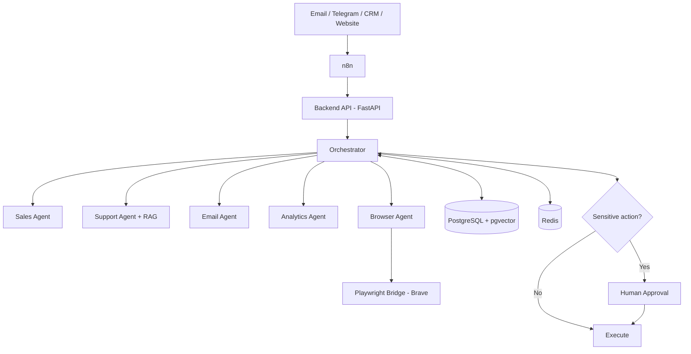

# Architecture

## Components
| Component | Role |
|---|---|
| n8n | Triggers, integrations, human approval flows |
| Backend (FastAPI) | Task API, orchestrator, agents |
| PostgreSQL + pgvector | Tasks, leads, emails, approvals, memory, RAG documents |
| Redis | Queue and cache |
| Playwright Bridge | Separate Node.js service controlling a real browser (runs on the host) |

## Task lifecycle
`pending` -> `running` -> `done` | `failed`, or `awaiting_approval` for sensitive actions.

## Security
- All services bind to `127.0.0.1`.
- Secrets live in `.env` (never committed).
- Sensitive actions require human approval.
